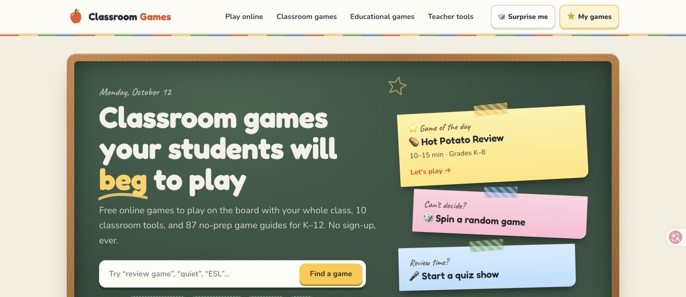

# Classroom Games — Free Games & Tools for K–12 Teachers

**[Visit classroom-games.net →](https://classroom-games.net/)**

Turn a lesson review, a spare five minutes or a rainy recess into a classroom activity. Classroom Games brings together free browser games, classroom tools and step-by-step game guides for kindergarten through high school.

## What you can use

- **[Online classroom games](https://classroom-games.net/play/):** 12 interactive games for a projector or smartboard. Play in teams on the teacher’s screen and add your own questions or words.
- **[Classroom game guides](https://classroom-games.net/games/):** 87 guides with instructions, suggested grades and playing times. Browse review games, brain breaks, icebreakers and quiet activities.
- **[Teacher tools](https://classroom-games.net/tools/):** 10 browser tools, including a countdown timer, random name picker, team generator, scoreboard and bingo card generator.
- **[Live classroom quiz](https://classroom-games.net/live/):** an option for classes where students can join on their phones, with quizzes, polls and word clouds.

The site is free to use and does not require an account. Choose a board game when students do not have devices, or a live quiz when they do.

## Find something for your next lesson

| What your class needs | Start here |
| --- | --- |
| Review yesterday’s lesson | [Classroom review games](https://classroom-games.net/types/review-games/) |
| A short movement break | [Brain break games](https://classroom-games.net/types/brain-breaks/) |
| An activity with little setup | [No-prep classroom games](https://classroom-games.net/types/no-prep/) |
| Practice for a particular subject | [Educational games](https://classroom-games.net/educational-games/) |
| A team quiz on the board | [Quiz Show](https://classroom-games.net/play/quiz-show/) |
| A clear time limit | [Classroom Timer](https://classroom-games.net/tools/timer/) |
| A starting list of ideas | [Best classroom games](https://classroom-games.net/best-classroom-games/) |

## Start in a few minutes

1. Pick a learning goal: retrieval practice, vocabulary, a brain break or getting to know the class.
2. Choose a game that fits the grade, available time and equipment.
3. Open it on your teacher computer. Project board games so everyone can see.
4. Explain the rules, choose teams or turns, and set a time limit.
5. Finish with a short recap: what did students remember, notice or learn?

For sample lesson routines, read the **[Teacher quick-start guide](docs/teacher-guide.md)**.

## Browse by age and subject

**Grades:** [Kindergarten](https://classroom-games.net/grades/kindergarten/) · [Elementary](https://classroom-games.net/grades/elementary/) · [Middle school](https://classroom-games.net/grades/middle-school/) · [High school](https://classroom-games.net/grades/high-school/)

**Subjects:** [Math](https://classroom-games.net/subjects/math/) · [ESL](https://classroom-games.net/subjects/esl/) · [Vocabulary & spelling](https://classroom-games.net/subjects/vocabulary-spelling/) · [Science](https://classroom-games.net/subjects/science/)

## About this repository

This is the public introduction and teacher resource guide for [Classroom Games](https://classroom-games.net/). All games and tools are available on the website.

Found a broken link or have an activity idea? [Open an issue](https://github.com/guyuedumingx/classroom-games-net/issues). Please describe the page and what you expected to happen.

**[Explore Classroom Games →](https://classroom-games.net/)**
